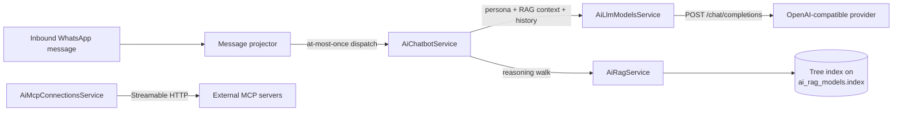

# 32 - AI Integration (Chatbots, LLM, Vectorless RAG, MCP)

## Implementation Status

> **Current Status: ✅ Implemented**
>
> AI Integration connects OpenWA to LLM providers and lets the gateway answer WhatsApp
> messages with an AI. Four instance kinds live under one surface — **Chatbot**, **AI LLM**,
> **RAG Vectorless** and **MCP Server** — and each is a full create/read/update/delete
> resource, managed from the dashboard's *AI Integration* page or the REST routes
> (`/api/ai/*`, `/api/sessions/:sessionId/ai-chatbots`).

| Component | Status | Location |
| --- | --- | --- |
| LLM provider connections (OpenAI-compatible) | ✅ Implemented | `src/modules/ai/ai-llm-models.service.ts` |
| Chatbot instances + inbound evaluation | ✅ Implemented | `src/modules/ai/ai-chatbot.service.ts` |
| Vectorless RAG (PageIndex-style tree) | ✅ Implemented | `src/modules/ai/ai-rag.service.ts` |
| Outbound MCP connections (client side) | ✅ Implemented | `src/modules/ai/ai-mcp-connections.service.ts` |
| REST surface (`/api/ai/*`) | ✅ Implemented | `src/modules/ai/*.controller.ts` |
| Inbound dispatch hook | ✅ Implemented | `src/modules/session/message-projector.service.ts` |
| Migration (5 tables) | ✅ Implemented | `src/database/migrations/1792000000000-AddAiIntegration.ts` |
| Dashboard page (four tabs) | ✅ Implemented | `dashboard/src/pages/AiIntegration.tsx` |

For the **server** side of MCP — exposing OpenWA's own tools to external agents — see
[24 - MCP Integration](./24-mcp-integration.md). This page covers the client side: connecting
the gateway to *other* MCP tool servers.

## 32.1 Overview



- **AI LLM** — a named OpenAI-compatible endpoint: base URL, API key, model id, sampling
  parameters (temperature / max tokens / top-p / stop) and an optional persona (a system
  prompt sent with every completion). The API key and custom headers are write-only: reads
  return a mask plus a boolean, the same posture as webhook `secret`.
- **Chatbot** — binds ONE session to an LLM model, an optional RAG model, a persona override,
  a chat allowlist, a per-chat cooldown and a context-window size. On the inbound dispatch (the
  same at-most-once fan-out the automation rules ride) the first matching enabled bot answers
  the chat through the ordinary send path — send pacing, plugin vetoes and audit included.
  Bots never answer their own messages, never answer messages older than five minutes (a
  reconnect replays the offline backlog through the same path), and answer `channel` /
  `broadcast` / `status` chats only when the operator bound them explicitly.
- **RAG Vectorless** — a named knowledge base. Entries are pasted words/information, a fetched
  URL, a site, or a stored file. *Indexing* builds a hierarchical tree PageIndex-style
  (segment → group → LLM summaries bottom-up, bounded at 120 completion calls); *retrieval*
  walks the tree with LLM reasoning instead of an embedding search — no vectors, no vector
  database, and every answer traces to an explicit node. A model activates on **all
  sessions**, **selected sessions** (`sessionScope`), or **none** (detached);
  `sessionScope: 'selected'` is enforced where a chatbot resolves its RAG model.
- **MCP Server** — an outbound connection to a Streamable-HTTP MCP server, with `none`,
  `bearer`, or custom-header authentication. `POST /ai/mcp-connections/:id/test` connects,
  initializes and lists the advertised tools; the tools are surfaced to the operator
  (dashboard) so they can be wired into AI flows.

## 32.2 Data model

Five tables (migration `1792000000000-AddAiIntegration`):

| Table | Purpose |
| --- | --- |
| `ai_llm_models` | Provider connections; `apiKey`/`headers` stored plaintext, never returned |
| `ai_chatbots` | Per-session bot instances; varchar `sessionId` FK with `ON DELETE CASCADE` |
| `ai_rag_models` | Knowledge bases; the tree index lives as JSON on the row (`index`, `indexedAt`) |
| `ai_rag_documents` | Knowledge entries (`text`/`url`/`site`/`file`) before indexing |
| `ai_mcp_connections` | Outbound MCP servers; `authCredential` write-only, masked on read |

Account-wide rows (`ai_llm_models`, `ai_rag_models`, `ai_mcp_connections`) have unique
`name`s; chatbots are unique per session by construction of the UI and capped per session.

## 32.3 Routes

All `/api/ai/*` routes require an API key. Reads are OPERATOR; everything that writes a row,
its credential or its activation scope is ADMIN. Chatbot routes live under the session
(`/api/sessions/:sessionId/ai-chatbots`) so the ApiKeyGuard's session fence scopes them like
webhooks.

| Route | Method | Role | Notes |
| --- | --- | --- | --- |
| `/api/ai/llm-models` | GET | OPERATOR | List (masked keys) |
| `/api/ai/llm-models` | POST | ADMIN | Create; 400 at `ai.llmModelsMax` |
| `/api/ai/llm-models/:id` | PUT / DELETE | ADMIN | Update / delete |
| `/api/ai/llm-models/:id/test` | POST | ADMIN | One minimal completion; records diagnostics |
| `/api/sessions/:sid/ai-chatbots` | GET/POST | OPERATOR | List / create for the session |
| `/api/sessions/:sid/ai-chatbots/:id` | PUT / DELETE | OPERATOR | Update / delete |
| `/api/ai/chatbots` | GET | OPERATOR | Cross-session list, scoped to the key's `allowedSessions` |
| `/api/ai/rag-models` | GET | OPERATOR | List with document counts and index state |
| `/api/ai/rag-models` | POST | ADMIN | Create |
| `/api/ai/rag-models/:id` | PUT / DELETE | ADMIN | Update (scope/topK/LLM override) / delete |
| `/api/ai/rag-models/:id/index` | POST | ADMIN | Build/rebuild the tree (LLM-mediated; minutes on large knowledge) |
| `/api/ai/rag-models/:id/query` | POST | OPERATOR | Retrieval probe: returns the cited nodes and the composed context |
| `/api/ai/rag-models/:id/documents` | GET / POST | OPERATOR / ADMIN | List / add knowledge |
| `/api/ai/rag-models/:id/documents/:docId` | PUT / DELETE | ADMIN | Update / delete knowledge |
| `/api/ai/mcp-connections` | GET | OPERATOR | List (masked credentials) |
| `/api/ai/mcp-connections` | POST | ADMIN | Create |
| `/api/ai/mcp-connections/:id` | PUT / DELETE | ADMIN | Update / delete |
| `/api/ai/mcp-connections/:id/test` | POST | OPERATOR | Connect + initialize + tools/list; records `lastStatus` |
| `/api/ai/mcp-connections/:id/tools` | GET | OPERATOR | Live tools/list |

Mutations land in the audit log under the `ai_llm_model_*`, `ai_chatbot_*`, `ai_rag_*` and
`ai_mcp_connection_*` actions.

## 32.4 Configuration

```bash
# AI_LLM_MODELS_MAX=50              # max LLM provider connections (default 50)
# AI_CHATBOTS_MAX_PER_SESSION=8     # max chatbot instances per session (default 8)
# AI_MCP_CONNECTIONS_MAX=50         # max outbound MCP server connections (default 50)
```

A create at/over a cap gets `400`; existing rows are grandfathered; `0` disables the cap.
Caps live in `src/config/configuration.ts` under the `ai` key and `.env.example` documents
them (see the AI INTEGRATION banner).

## 32.5 Security notes

- **Credentials are write-only.** LLM API keys, custom-header maps and MCP credentials are
  never returned by any route; the dashboard shows a mask plus a boolean. A restore that
  bypasses the DTO is re-checked at use time (`sanitizeHeaderMap` drops reserved names like
  `authorization`), so a shadowed auth header cannot reach a provider request.
- **SSRF.** Every outbound call — completion, RAG URL fetch, MCP connect — runs the shared
  SSRF guard (`withSafeFetch` / `resolveSafeFetchTarget`), so registrations to internal
  addresses are refused exactly as webhook deliveries are. `WEBHOOK_SSRF_PROTECT=false`
  releases all of them in a closed network.
- **Chatbot blast radius.** A bot speaks as the WhatsApp account. The chat allowlist, the
  channel/broadcast/status opt-in and the cooldown bound what it can answer; the audit row on
  every mutation records who changed it.
- **RAG index budget.** One index build spends at most 120 completion calls and one retrieval
  walk at most 4; a build that exceeds the budget fails with the error on the row
  (`lastIndexError`) and the previous index stays live until a rebuild commits.

## 32.6 Dashboard

The **AI Integration** page (`/ai-integration`, admin, unscoped keys only) has four tabs in
the webhook-card style: Chatbot, AI LLM, RAG Vectorless, MCP Server. Each tab is a card list
with create/edit/delete modals, an enable/disable toggle, a test action (LLM/MCP) and — on
RAG rows — an expandable knowledge editor (add text/url/site entries, add/delete, rebuild
index) plus a retrieval probe box. All of the page's strings ship in every of the fifteen
dashboard locales.
