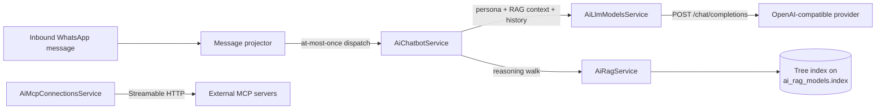

# 32 - AI Integration (Chatbots, LLM, Vectorless RAG, MCP)

## Implementation Status

> **Current Status: ✅ Implemented**
>
> AI Integration connects OpenWA to LLM providers and lets the gateway answer WhatsApp
> messages with an AI. Four instance kinds live under one surface — **Chatbot**, **AI LLM**,
> **RAG Vectorless** and **MCP Server** — and each is a full create/read/update/delete
> resource, managed from the dashboard's *AI Integration* page or the REST routes
> (`/api/ai/*`, `/api/sessions/:sessionId/ai-chatbots`).

| Component | Status | Location |
| --- | --- | --- |
| LLM provider connections (OpenAI-compatible) | ✅ Implemented | `src/modules/ai/ai-llm-models.service.ts` |
| Chatbot instances + per-chat switches + inbound evaluation | ✅ Implemented | `src/modules/ai/ai-chatbot.service.ts` |
| Vectorless RAG (PageIndex-style tree) | ✅ Implemented | `src/modules/ai/ai-rag.service.ts` |
| Outbound MCP connections (client side) | ✅ Implemented | `src/modules/ai/ai-mcp-connections.service.ts` |
| REST surface (`/api/ai/*`) | ✅ Implemented | `src/modules/ai/*.controller.ts` |
| Inbound dispatch hook | ✅ Implemented | `src/modules/session/message-projector.service.ts` |
| Migration (5 tables) | ✅ Implemented | `src/database/migrations/1792000000000-AddAiIntegration.ts` |
| Dashboard page (four tabs) | ✅ Implemented | `dashboard/src/pages/AiIntegration.tsx` |

For the **server** side of MCP — exposing OpenWA's own tools to external agents — see
[24 - MCP Integration](./24-mcp-integration.md). This page covers the client side: connecting
the gateway to *other* MCP tool servers.

## 32.1 Overview

- **AI LLM** — a named OpenAI-compatible endpoint: base URL, API key, model id and sampling
  parameters (temperature / max tokens / top-p / stop), defaulting to `temperature: 0.7` and
  `maxTokens: 1024` when omitted on create. A `.../v1` base URL and a full
  `.../v1/chat/completions` URL both work. It carries **no persona** — the persona belongs to
  the chatbot. The API key and custom headers are write-only: reads return a mask plus a
  boolean, the same posture as webhook `secret`. A completion that times out names the endpoint
  and the 60 s budget; a reply that is not JSON surfaces the response's first bytes so a
  redirect/HTML page is obvious.
- **Chatbot** — binds ONE session to an LLM model, an optional RAG model, **the persona** (its
  only system prompt) and a `replyGroups` opt-in. While `enabled`, every chat of the session is
  answered by default; the **Chats page** carries a per-conversation AI ON/OFF chip that writes
  an `ai_chat_overrides` row for the muted pairs (`POST /api/ai/chat-state`), so a single
  conversation can be silenced without touching the bot. On the inbound dispatch (the same
  at-most-once fan-out the automation rules ride) the first matching enabled bot answers the
  chat through the ordinary send path — send pacing, plugin vetoes and audit included. While the
  LLM turn runs, the bot shows a real **typing indicator** in the chat (`sendChatState('typing')`,
  re-armed every 4 s so it outlives WhatsApp's ~6 s presence expiry) and closes it with `paused`
  once the reply goes out — strictly best-effort, and only when a typing frame was actually shown.
  Bots
  never answer their own messages, never answer messages older than five minutes (a reconnect
  replays the offline backlog through the same path), never answer `channel` / `broadcast` /
  `status` chats, and answer groups only when `replyGroups` is on. The per-chat switch is
  **dialect-safe**: a 1:1 chat's id flips between `<lid>@lid` and `<phone>@c.us` as the engine
  learns the mapping, so a mute written under one form silences the conversation under the other,
  and switching the bot back on for a chat removes the mute in EVERY stored form (the removal
  matches the shared JID-alias expansion, not just the literal id the page sent).
- **RAG Vectorless** — a named knowledge base, implemented in **TypeScript on Node** (no Python
  worker, no embedding service). Entries are pasted words/information, a fetched URL, a site,
  or a stored file. A url/site/file entry is **ingested in the background**: the row lands as
  `pending`, the dashboard polls it (`processing` → `ready` or `failed` with the reason), and
  a dead link never wedges the request that added it. *Indexing* builds a hierarchical tree
  PageIndex-style (segment → group → LLM summaries bottom-up, bounded at 120 completion calls);
  *retrieval* walks the tree with LLM reasoning instead of an embedding search — no vectors, no
  vector database, and every answer traces to an explicit node. A model activates on **all
  sessions**, **selected sessions** (`sessionScope`), or **none** (detached);
  `sessionScope: 'selected'` is enforced where a chatbot resolves its RAG model.
- **MCP Server** — an outbound connection to an MCP server, over **Streamable HTTP** (default)
  or **SSE** (`transport: 'sse'`), with `none`, `bearer`, or custom-header authentication.
  `POST /ai/mcp-connections/:id/test` connects, initializes and lists the advertised tools; the
  tools are surfaced to the operator (dashboard) **and callable by the chatbots**: the reply loop
  offers every tool of every enabled connection to the model (namespaced per connection), executes
  what the model calls via `tools/call`, and feeds each result back as a `tool` turn — up to 5
  rounds, then the model must answer from what it has. A bot's `mcpToolIds` narrows the surface
  (`"<connectionId>:<toolName>"` entries); empty/`null` means EVERY advertised tool, so a server
  gaining a tool needs no bot edit. A down server shrinks the surface; a failing tool lands to the
  model as an error string, never as a thrown reply.

## 32.2 Data model

Seven tables (migrations `1792000000000-AddAiIntegration`, `1793000000000-ReviseAiIntegration` and `1794000000000-AddAiChatbotMcpTools`):

| Table | Purpose |
| --- | --- |
| `ai_llm_models` | Provider connections; `apiKey`/`headers` stored plaintext, never returned. No persona — the chatbot owns it |
| `ai_chatbots` | Per-session bot instances: THE persona, a `replyGroups` opt-in and an `mcpToolIds` tool narrowing (null = every tool the enabled MCP connections offer); varchar `sessionId` FK with `ON DELETE CASCADE`. No chat allowlist / cooldown / history knobs — the per-chat switches replaced them |
| `ai_chat_overrides` | The Chats-page switches: one row per muted `(chatbotId, chatId)` pair; a missing row means answered |
| `ai_rag_models` | Knowledge bases; the tree index lives as JSON on the row (`index`, `indexedAt`) |
| `ai_rag_documents` | Knowledge entries with an ingestion `status` (`pending` → `processing` → `ready` \| `failed` + `statusError`); url/site/file are fetched in the background |
| `ai_mcp_connections` | Outbound MCP servers; `transport` (`streamable-http` \| `sse`), `authCredential` write-only, masked on read |

Account-wide rows (`ai_llm_models`, `ai_rag_models`, `ai_mcp_connections`) have unique
`name`s; chatbots are unique per session by construction of the UI and capped per session.

## 32.3 Routes

All `/api/ai/*` routes require an API key. Reads are OPERATOR; everything that writes a row,
its credential or its activation scope is ADMIN. Chatbot routes live under the session
(`/api/sessions/:sessionId/ai-chatbots`) so the ApiKeyGuard's session fence scopes them like
webhooks.

| Route | Method | Role | Notes |
| --- | --- | --- | --- |
| `/api/ai/llm-models` | GET | OPERATOR | List (masked keys) |
| `/api/ai/llm-models` | POST | ADMIN | Create; 400 at `ai.llmModelsMax` |
| `/api/ai/llm-models/:id` | PUT / DELETE | ADMIN | Update / delete |
| `/api/ai/llm-models/:id/test` | POST | ADMIN | One minimal completion; records diagnostics |
| `/api/sessions/:sid/ai-chatbots` | GET/POST | OPERATOR | List / create for the session |
| `/api/sessions/:sid/ai-chatbots/:id` | PUT / DELETE | OPERATOR | Update / delete |
| `/api/sessions/:sid/ai-chatbots/:id/test` | POST | OPERATOR | The Playground: one production-shaped answer for a pasted message, without sending it |
| `/api/ai/chat-states` | GET | OPERATOR | The per-chat AI switches (which bots are muted per conversation) |
| `/api/ai/chat-state` | POST | OPERATOR | Flip one (chatbot, chat) switch — the Chats page toggles |
| `/api/ai/chatbots` | GET | OPERATOR | Cross-session list, scoped to the key's `allowedSessions` |
| `/api/ai/rag-models` | GET | OPERATOR | List with document counts and index state |
| `/api/ai/rag-models` | POST | ADMIN | Create |
| `/api/ai/rag-models/:id` | PUT / DELETE | ADMIN | Update (scope/topK/LLM override) / delete |
| `/api/ai/rag-models/:id/index` | POST | ADMIN | Build/rebuild the tree (LLM-mediated; minutes on large knowledge) |
| `/api/ai/rag-models/:id/query` | POST | OPERATOR | Retrieval probe: returns the cited nodes and the composed context |
| `/api/ai/rag-models/:id/documents` | GET / POST | OPERATOR / ADMIN | List / add knowledge |
| `/api/ai/rag-models/:id/documents/:docId` | PUT / DELETE | ADMIN | Update / delete knowledge |
| `/api/ai/mcp-connections` | GET | OPERATOR | List (masked credentials) |
| `/api/ai/mcp-connections` | POST | ADMIN | Create |
| `/api/ai/mcp-connections/:id` | PUT / DELETE | ADMIN | Update / delete |
| `/api/ai/mcp-connections/:id/test` | POST | OPERATOR | Connect + initialize + tools/list; records `lastStatus` |
| `/api/ai/mcp-connections/:id/tools` | GET | OPERATOR | Live tools/list |

Mutations land in the audit log under the `ai_llm_model_*`, `ai_chatbot_*`, `ai_rag_*` and
`ai_mcp_connection_*` actions.

## 32.4 Configuration

Two layers, and they are deliberately different:

**Per-instance configuration** (which LLM, which chatbot, which knowledge, which MCP server) is
**rows**, managed in the *AI Integration* page and the `/api/ai/*` routes. It needs no restart.

**Deployment-level flags and caps** are **environment-shaped** — they are read at boot (the MCP
server module is mounted or not by a flag) — so they live in the *Infrastructure* page next to the
database, Redis, storage and engine settings, and apply after the restart that page already offers:

| Setting | Env key | Meaning |
| --- | --- | --- |
| Expose the MCP server | `MCP_ENABLED` | Mount the OpenWA agent tool server at `POST /mcp` |
| Read-only MCP tools | `MCP_READONLY` | Expose only read tools (default) |
| Max LLM models | `AI_LLM_MODELS_MAX` | Cap on provider connections (default 50) |
| Max bots / session | `AI_CHATBOTS_MAX_PER_SESSION` | Cap on chatbot instances per session (default 8) |
| Max MCP connections | `AI_MCP_CONNECTIONS_MAX` | Cap on outbound MCP servers (default 50) |
| Allow private AI endpoints | `SSRF_ALLOWED_HOSTS=*` | Let AI calls reach a self-hosted Ollama/vLLM on your network |

Saving writes `data/.env.generated` (the same file every other Infrastructure section uses) and
the page's restart flow applies it. A create at/over a cap gets `400`; existing rows are
grandfathered; `0` disables the cap. Caps live in `src/config/configuration.ts` under the `ai`
key, and `.env.example` documents them under the AI INTEGRATION banner.

## 32.5 Security notes

- **Credentials are write-only.** LLM API keys, custom-header maps and MCP credentials are
  never returned by any route; the dashboard shows a mask plus a boolean. A restore that
  bypasses the DTO is re-checked at use time (`sanitizeHeaderMap` drops reserved names like
  `authorization`), so a shadowed auth header cannot reach a provider request.
- **SSRF.** Every outbound call — completion, RAG URL fetch, MCP connect — runs the shared
  SSRF guard (`withSafeFetch` / `resolveSafeFetchTarget`), so registrations to internal
  addresses are refused exactly as webhook deliveries are. `WEBHOOK_SSRF_PROTECT=false`
  releases all of them in a closed network.
- **Chatbot blast radius.** A bot speaks as the WhatsApp account. The bot's `enabled` state,
  the `replyGroups` opt-in, the five-minute staleness floor and the per-chat
  `ai_chat_overrides` switches (default: every chat answered) bound what it can answer; the
  audit row on every mutation records who changed it.
- **Backups.** All six AI tables ride `GET /api/infra/export-data` / `POST /api/infra/import-data`
  (`aiLlmModels`, `aiChatbots`, `aiChatOverrides`, `aiRagModels`, `aiRagDocuments`,
  `aiMcpConnections`): a chatbot dies with its session (CASCADE) and an override with its
  bot, so restoring a backup reproduces the full AI setup — bots, personas, muted chats,
  knowledge bases and MCP connections — without re-entry. LLM API keys and MCP credentials in
  a backup are stored plaintext in the archive, like the rest of the export.
- **RAG index budget.** One index build spends at most 120 completion calls and one retrieval
  walk at most 4; a build that exceeds the budget fails with the error on the row
  (`lastIndexError`) and the previous index stays live until a rebuild commits.

## 32.6 Dashboard

The **AI Integration** page (`/ai-integration`, admin, unscoped keys only) has five tabs in
the webhook-card style: Chatbot, AI LLM, RAG Vectorless, MCP Server and Playground. Each resource
tab is a card list with create/edit/delete modals, an enable/disable toggle, a test action
(LLM/MCP) and — on RAG rows — an expandable knowledge editor (add text/url/site entries,
add/delete, rebuild index) plus a retrieval probe box.

Every card title carries an **enable dot** — green while the row is enabled, red once it is
switched off — and the toggle button names the state it is in (`Enabled — Disable` /
`Disabled — Enable`), so the state reads without opening the edit form.

The **Playground** tab answers a typed message through the bot's real prompt and shows the reply
in a WhatsApp-shaped transcript, with the RAG source titles the answer stood on and any retrieval
warnings under it. Pick the bot at the top; the header repeats its enable state, its LLM model and
its knowledge base, each with the same dot. Nothing is sent: the probe calls
`POST /api/sessions/:sid/ai-chatbots/:id/test`, which assembles persona + knowledge + history and
returns the completion only, so no chat row, no `lastRepliedAt` write and no outbound WhatsApp
message result. A disabled bot, or one whose LLM model is switched off, is flagged inline — the
probe still reports why it cannot answer instead of pretending to be a live test. All of the
page's strings ship in every of the fifteen dashboard locales.
